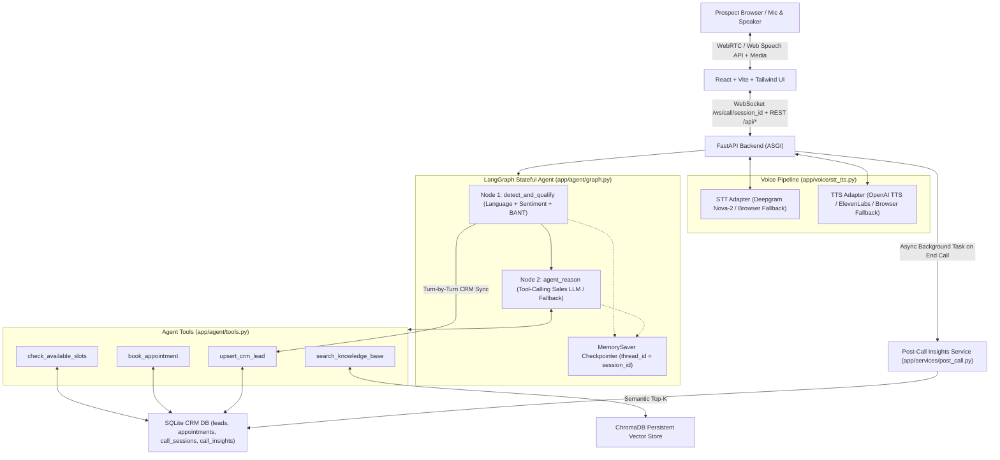
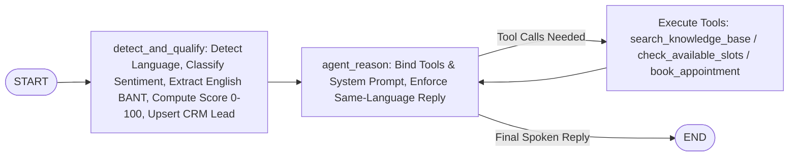
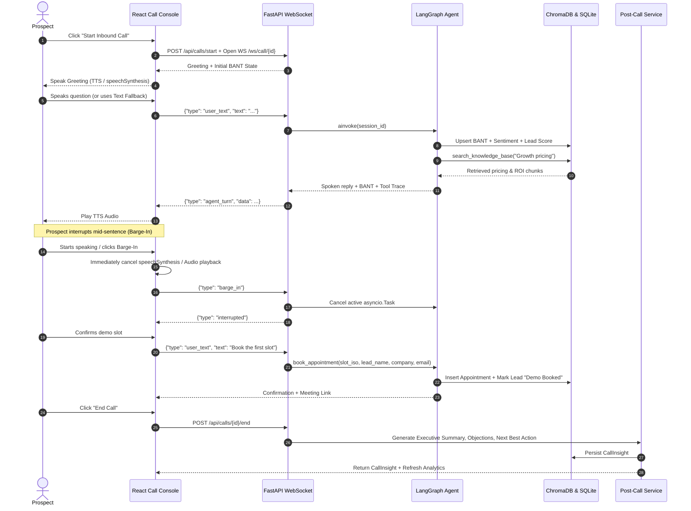

# System Architecture — NovaFlow AI Autonomous Sales Voice Agent

This document describes the end-to-end architecture, LangGraph state orchestration, and real-time voice/barge-in data flow for the **Autonomous AI Sales Voice Agent** MVP.

---

## 1. High-Level System Architecture

---

## 2. LangGraph Multi-Turn State Flow

On every prospect utterance, the graph executes two deterministic stages backed by a session-scoped `MemorySaver` checkpoint (`thread_id = session_id`):

### Key Architectural Invariants
1. **Multilingual Input, Normalized CRM Output:** Regardless of whether the prospect speaks English, Spanish, or Hindi, `detect_and_qualify` instructs the extractor to normalize BANT fields (`budget`, `authority`, `need`, `timeline`) to English before persisting to SQLite, while `agent_reason` replies fluently in `detected_language`.
2. **RAG-Grounded Responses:** Pricing tiers, Salesforce/HubSpot integration specs, SOC 2 security answers, and objection rebuttals are retrieved from ChromaDB (`pricing.md`, `product_features.md`, `objection_handling.md`) before generating an answer.
3. **Graceful Zero-Key Resilience:** If external API keys (`OPENAI_API_KEY`, `DEEPGRAM_API_KEY`, `ELEVENLABS_API_KEY`) are absent or fail during a live evaluation, every layer degrades gracefully to local embeddings, deterministic NLP/RAG orchestration, and browser Web Speech API / `speechSynthesis`.

---

## 3. End-to-End Voice Call & Barge-In Sequence

